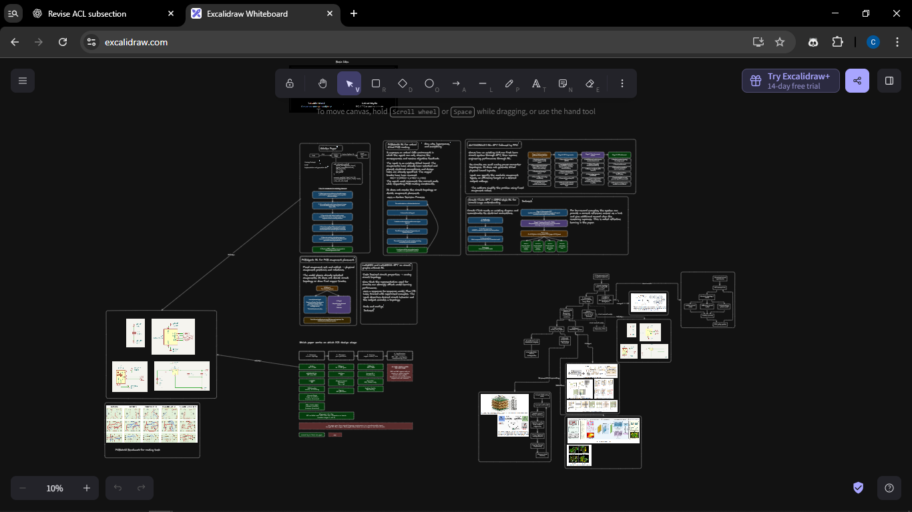
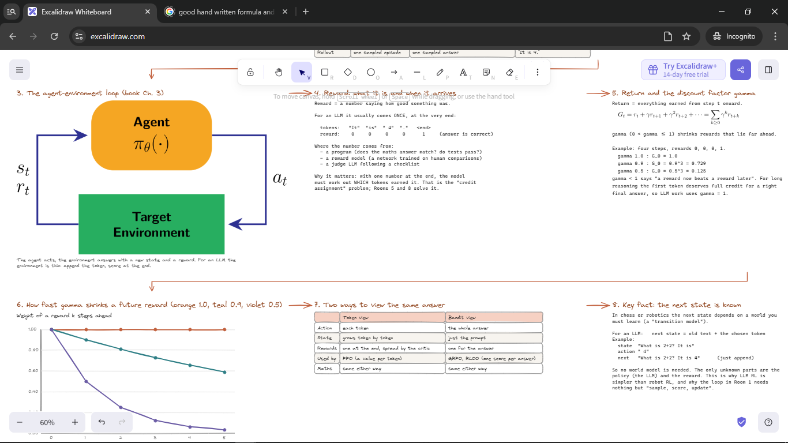
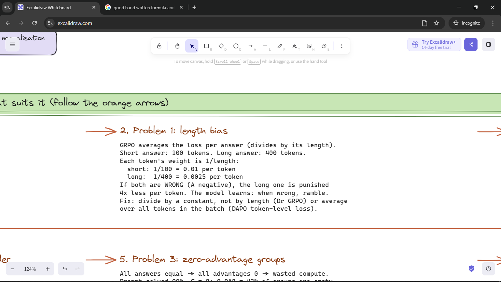

# BrainMaps

**Turn dense source material into visual study boards you can explore and edit.**

BrainMaps is a plugin for Codex and Claude Code that creates editable Excalidraw mind maps, chapter study boards, research overviews, and diagrams from PDFs, slides, papers, and notes. It connects explanations with annotated formulas, figures, worked examples, and answered practice questions. Open the resulting `.excalidraw` file in [Excalidraw](https://excalidraw.com) to explore and edit the board.

## See the style

These existing board screenshots come from the bundled reference gallery used to guide BrainMaps. They illustrate the intended output style; they are not fresh renders of the included sample.

### Research at a glance

Paper cards, process diagrams, embedded figures, and a coverage matrix share one connected canvas.



### Study a concept from several angles

This reinforcement-learning board connects the agent-environment loop to explanations, equations, a discount chart, and a comparison table.



### Follow the details

Worked examples show the rule, the numbers, the calculation, and the consequence together.



## Install in Codex

Run these commands in your terminal with a current Codex CLI:

```sh
codex plugin marketplace add ButWhySo/BrainMaps
codex plugin add brainmaps@brainmaps
```

Start a new Codex session and invoke `$brainmaps`, or ask Codex to use BrainMaps with your source files.

## Install in Claude Code

Run these commands in your terminal:

```sh
claude plugin marketplace add ButWhySo/BrainMaps
claude plugin install brainmaps@brainmaps
```

Alternatively, run `/plugin install brainmaps --marketplace ButWhySo/BrainMaps` inside Claude Code. Start a new session and invoke `/brainmaps:brainmaps`.

## Set up the Python tools

The packaged builder requires Python 3 and Pillow. Clone the repository to install its dependency and check the bundled assets:

```sh
git clone https://github.com/ButWhySo/BrainMaps.git
cd BrainMaps
python -m pip install -r requirements.txt
python skills/brainmaps/scripts/check_install.py
```

Use `py` on Windows or `python3` on macOS/Linux if that is your Python launcher. Typeset formula images additionally require `pdflatex` from TeX Live or MiKTeX and `pdftocairo` from Poppler. Without them, formulas fall back to text. The plugin contains no MCP server and requires no additional API credentials.

## Use it

Give your agent the source files and a concrete request:

> Use BrainMaps to turn this lecture into a complete editable study board. Follow the source order, explain each formula, include worked examples, and answer the practice questions. Inspect the bundled gallery before building.

Ask for an overview board, a single pipeline diagram, or a detailed board with one room per source section. The skill directs the agent to inspect the source and gallery, adapt layouts to the content, build the board, and audit it before delivery. Source extraction, OCR, browser access, and rendered previews depend on the tools available in your agent environment.

## Documentation

See [INSTALL.md](INSTALL.md) for local plugin testing, standalone skill installation, and the sample build. The entire `skills/brainmaps/` directory must travel with the skill, including its scripts, examples, and 17 reference images. See [VALIDATION.md](VALIDATION.md) for checks actually run and their limits.

Installation guidance was checked on November 12, 2026 against the official [OpenAI plugin packaging documentation](https://developers.openai.com/plugins/build/plugins), [Codex CLI commands](https://learn.chatgpt.com/docs/developer-commands), [Claude Code manifest reference](https://code.claude.com/docs/en/plugins-reference), and [Claude marketplace documentation](https://code.claude.com/docs/en/plugin-marketplaces).

## License

The code and skill are distributed under the [GNU GPL version 2](LICENSE). Embedded third-party figures and reference screenshots retain their original rights and attribution; the code license does not grant additional rights to those materials.
